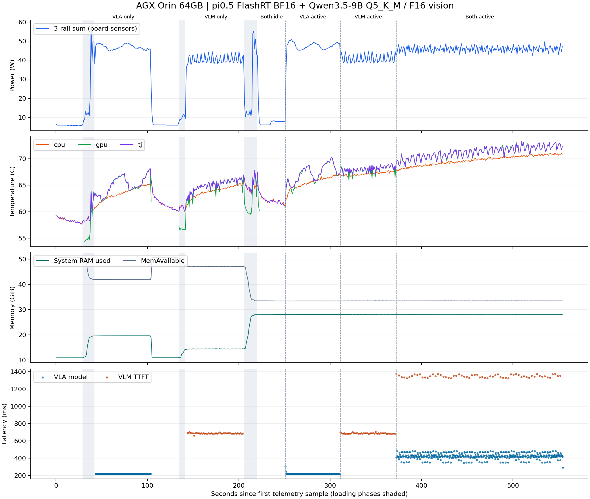

# π0.5 + Qwen3.5-9B：Orin 双模型部署实测

## 结论

两套模型可同时常驻。只增加常驻而不同时计算时，延时接近各自单独运行；同时持续推理时，VLA模型均值从220.80 ms升到427.42 ms（1.94×）。
并发持续182.4秒，VLM首字均值1350.02 ms、完整短回答均值2846.74 ms。
并发系统RAM观测峰值28.17 GiB，可用内存最低33.37 GiB；GPU最高73.28 °C；板载三轨功耗均值/采样最大值45.82/49.70 W。
全部已完成场景的系统Swap观测最大值为0.75 MiB；这是系统总量，不能归为模型独占。
本轮主要代价是同时计算时的延时增长；未进一步量化计算、内存带宽和GPU调度各自贡献。若动作更新延时优先，可先让VLM按事件/低频触发；这项调度建议尚未实施测试。

模型：π0.5 LIBERO / FlashRT BF16；Qwen3.5-9B / Q5_K_M 语言权重 + FP16 视觉模块。batch=1，VLM context=8192、并发槽位1、温度0、最多96个输出token、关闭thinking和prompt缓存。

VLA输入复用已提交的合成双相机/任务/固定噪声，输出10×7，10轮去噪。VLM使用两张512×384程序绘制桌面图交替请求；只用于性能和看图接口检查，不代表真实机器人成功率。

## 延时

API为Orin本机loopback HTTP。VLA纯模型边界是输入CUDA-ready到原完整生产图输出完成，不含上传、下载；服务为拆分计时增加边界同步，与历史未插桩policy并非同一采样口径。VLM TTFT从发送HTTP请求到收到第一个非空可见文本，包含图像处理、prefill、排队与传输。prompt/decode为llama.cpp回传内部timings，prompt_ms不能未经审计就当作独立视觉编码耗时。

相机采集和客户端PNG/base64编码均在测试前完成、不计入API时间。VLA API计时含客户端JSON序列化；VLM在构造好HTTP请求后开始计时，不含该序列化。

decode tok/s与该llama.cpp版本一致：首token在prompt阶段产生，用后续N−1个decode间隔除以predicted_ms。API完整回答时间同时保留，不能用纯decode速率推断整次请求耗时。

| 场景 | VLA n | VLA API mean / p95 ms | VLA 模型 mean / p95 ms | VLM n | VLM TTFT mean / p95 ms | VLM 完整 mean / p95 ms | decode tok/s |
|---|---:|---:|---:|---:|---:|---:|---:|
| 系统空闲基线（原π0.5已停） | 0 | N/A / N/A | N/A / N/A | 0 | N/A / N/A | N/A / N/A | N/A |
| VLA 单独常驻与推理 | 240 | 250.43 / 253.92 | 220.80 / 220.99 | 0 | N/A / N/A | N/A / N/A | N/A |
| VLM 单独常驻与推理 | 0 | N/A / N/A | N/A / N/A | 46 | 688.39 / 693.08 | 1330.82 / 1356.49 | 21.02 |
| 双模型常驻空闲 | 0 | N/A / N/A | N/A / N/A | 0 | N/A / N/A | N/A / N/A | N/A |
| 双常驻，仅 VLA 推理 | 240 | 250.45 / 252.45 | 220.94 / 220.80 | 0 | N/A / N/A | N/A / N/A | N/A |
| 双常驻，仅 VLM 推理 | 0 | N/A / N/A | N/A / N/A | 46 | 688.20 / 694.17 | 1330.30 / 1354.72 | 21.03 |
| 双模型同时持续推理 | 393 | 463.69 / 511.56 | 427.42 / 472.93 | 64 | 1350.02 / 1374.63 | 2846.74 / 2915.75 | 9.01 |

## VLA 分步骤延时（mean / p95 ms）

| 场景 | HTTP解码 | 输入准备+上传 | 原模型 | 下载+动作处理 |
|---|---:|---:|---:|---:|
| VLA 单独常驻与推理 | 8.18 / 9.17 | 4.01 / 6.57 | 220.80 / 220.99 | 0.99 / 1.15 |
| 双常驻，仅 VLA 推理 | 8.12 / 9.12 | 4.17 / 4.49 | 220.94 / 220.80 | 1.03 / 1.41 |
| 双模型同时持续推理 | 8.17 / 9.12 | 5.87 / 7.28 | 427.42 / 472.93 | 4.64 / 5.49 |

## VLM 内部计时（mean / p95）

| 场景 | prompt ms | decode ms | prompt tokens | generated tokens | reused cache tokens | 长度截断次数 |
|---|---:|---:|---:|---:|---:|---:|
| VLM 单独常驻与推理 | 612.78 / 613.72 | 642.16 / 666.42 | 226.00 / 226.00 | 14.50 / 15.00 | 0.00 / 0.00 | 0 |
| 双常驻，仅 VLM 推理 | 612.51 / 614.40 | 641.88 / 666.02 | 226.00 / 226.00 | 14.50 / 15.00 | 0.00 / 0.00 | 0 |
| 双模型同时持续推理 | 1270.87 / 1302.08 | 1497.87 / 1577.31 | 226.00 / 226.00 | 14.50 / 15.00 | 0.00 / 0.00 | 0 |

## 内存、温度与板载功耗

统一内存的RSS/PSS、NvMap、全设备/系统RAM记账存在重叠，不能相加。下表为1 Hz观察最大值，可能漏掉短暂分配；加载阶段另列。MemAvailable为Linux估计可用容量；RAM为tegrastats当前使用量，不是两模型独占物理内存。

| 场景 | 时长s / 采样数 | 系统RAM max GiB | MemAvailable min GiB | VLA NvMap / RSS max GiB | VLM NvMap / RSS max GiB | CPU / GPU / tj max °C | 三轨功耗 mean / max W |
|---|---:|---:|---:|---:|---:|---:|---:|
| 系统空闲基线（原π0.5已停） | 30.0 / 29 | 10.91 | 50.62 | N/A / N/A | N/A / N/A | 59.25 / N/A / 59.25 | 5.82 / 6.48 |
| load_vla | 13.0 / 13 | 19.56 | 41.97 | 12.79 / 6.00 | N/A / N/A | 60.38 / 63.97 / 63.97 | 23.11 / 58.19 |
| VLA 单独常驻与推理 | 60.2 / 59 | 19.62 | 41.91 | 12.79 / 1.00 | N/A / N/A | 65.12 / 68.03 / 68.19 | 46.85 / 49.01 |
| load_vlm | 7.0 / 7 | 14.06 | 47.47 | N/A / N/A | 7.72 / 0.99 | 61.28 / 57.16 / 61.16 | 9.69 / 11.44 |
| VLM 单独常驻与推理 | 61.3 / 61 | 14.52 | 47.03 | N/A / N/A | 7.78 / 1.42 | 65.44 / 66.97 / 66.97 | 40.48 / 44.59 |
| load_vla_with_vlm | 14.0 / 14 | 28.02 | 33.51 | 12.76 / 5.81 | 7.78 / 1.31 | 66.12 / 67.84 / 67.84 | 25.93 / 55.19 |
| 双模型常驻空闲 | 30.0 / 30 | 28.11 | 33.42 | 12.76 / 1.00 | 7.78 / 1.31 | 64.22 / 61.31 / 64.22 | 7.47 / 18.12 |
| 双常驻，仅 VLA 推理 | 60.2 / 59 | 28.12 | 33.40 | 12.76 / 1.01 | 7.78 / 1.31 | 67.03 / 70.31 / 70.31 | 47.35 / 50.86 |
| 双常驻，仅 VLM 推理 | 61.2 / 61 | 28.18 | 33.37 | 12.76 / 1.01 | 7.78 / 1.42 | 67.94 / 69.16 / 69.16 | 40.81 / 44.93 |
| 双模型同时持续推理 | 182.4 / 180 | 28.17 | 33.37 | 12.76 / 1.01 | 7.78 / 1.42 | 71.16 / 73.28 / 73.28 | 45.82 / 49.70 |

功耗定义：VDD_GPU_SOC + VDD_CPU_CV + VIN_SYS_5V0 的当前读数合计。**VDDQ已包含在VIN_SYS_5V0，不重复相加；SUMMATION也不重复相加。**这是板载电源轨合计近似值，含系统背景负载，未用外接功率计测交流插座功耗。mean不是扣除空闲后的模型净功耗；逐轨数据和采样区间能量保留在summary.json。
[NVIDIA AGX Orin电源轨定义](https://docs.nvidia.com/jetson/archives/r36.3/DeveloperGuide/SD/PlatformPowerAndPerformance/JetsonOrinNanoSeriesJetsonOrinNxSeriesAndJetsonAgxOrinSeries.html#software-based-power-consumption-modeling)

## 硬件事件计数

记录soctherm-oc-event的原始OC计数，不能仅凭计数不增长推断完全没有热/电限频。每场景首末采样的差值保存在summary.json；跨场景边界还可核对environment-before/after.json。

| 场景 | OC1 增量 | OC2 增量 | OC3 增量 |
|---|---:|---:|---:|
| 系统空闲基线（原π0.5已停） | 0 | 0 | 0 |
| load_vla | 0 | 0 | 1 |
| warm_vla | 0 | 0 | 0 |
| VLA 单独常驻与推理 | 0 | 0 | 0 |
| idle_between_models | 0 | 0 | 0 |
| load_vlm | 0 | 0 | 0 |
| warm_vlm | 0 | 0 | 0 |
| VLM 单独常驻与推理 | 0 | 0 | 0 |
| load_vla_with_vlm | 0 | 0 | 3 |
| warm_vla_dual | N/A | N/A | N/A |
| 双模型常驻空闲 | 0 | 0 | 0 |
| 双常驻，仅 VLA 推理 | 0 | 0 | 0 |
| 双常驻，仅 VLM 推理 | 0 | 0 | 0 |
| 双模型同时持续推理 | 0 | 0 | 0 |

AGX Orin 64GB的NVIDIA默认定义将OC3对应CPU_CV_GPU_SOC瞬时功耗限制事件；1Hz功耗采样可能漏掉触发事件的瞬时尖峰，计数不能换算为限频持续时间。[NVIDIA OC定义](https://docs.nvidia.com/jetson/archives/r36.3/DeveloperGuide/SD/PlatformPowerAndPerformance/JetsonOrinNanoSeriesJetsonOrinNxSeriesAndJetsonAgxOrinSeries.html#overcurrent-event-status)

## 数值与运行边界

VLA每个进程分别建立first-output reference，所有测量输出要求与该实例逐元素一致。跨进程GEMM调优可能有数值差异，不要求两个实例互相bitwise一致；相对官方baseline的误差记录在provenance的vla_instances。VLM文字输出和实际输出token数均保存；这些合成图片没有构成任务精度评测。

**VLM 单独常驻与推理 示例输出：**

```text
从左到右分别是红色的杯子、蓝色的立方体和绿色的球。
从左到右分别是蓝色杯子、红色立方体和黄色球体。
```

**双常驻，仅 VLM 推理 示例输出：**

```text
从左到右分别是红色的杯子、蓝色的立方体和绿色的球。
从左到右分别是蓝色杯子、红色立方体和黄色球体。
```

**双模型同时持续推理 示例输出：**

```text
从左到右分别是红色的杯子、蓝色的立方体和绿色的球。
从左到右分别是蓝色杯子、红色立方体和黄色球体。
```

## 时间轴



图表由plot_results.py读取原始采样生成，灰色区域为加载；不插值补造温度缺失值。

## 限制与复现

场景按固定顺序执行，未做随机交叉或恒温稳态控制；温度、频率可能随顺序漂移。同时持续推理使用默认GPU调度，无任务优先级保证；测试持续时间不代表长时间热稳态认证。后台监控统一为1 Hz，未单独校准其开销；未改功耗模式、锁频或风扇设置。
完整命令、源码与模型SHA、原服务状态见provenance.json；requests.jsonl保存全部SSE/动作响应，telemetry.jsonl保存带单调时间的原始tegrastats、proc、NvMap、MemAvailable和Swap。
GPU运行时脚本快照SHA见provenance；后处理代码随后完善，其实际SHA与输入SHA单独保存在postprocessing.json。
新服务和复现说明见[dual_stack/README.md](../../dual_stack/README.md)。
