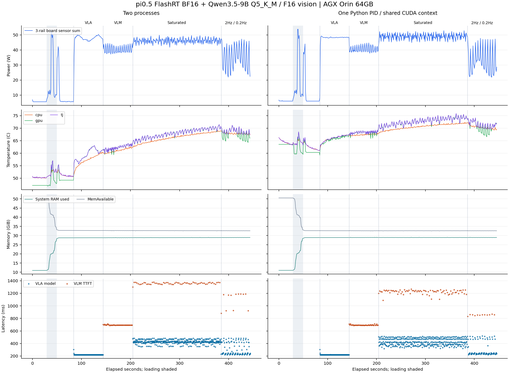

# π0.5 + Qwen3.5-9B：同进程共享CUDA上下文版测评

本轮重新测量双进程对照及共享上下文实现。持续并发时VLA模型均值由427.71 ms变为428.22 ms，前者/后者为0.999；VLM完整短回答由2856.64 ms变为2302.75 ms，前者/后者为1.241。
比值大于1代表新版本更快，小于1代表变慢；这些是本次设备/输入/顺序下的结果，不预设同进程一定加速。

## 实现与上下文证据

保留同一FlashRT BF16、Qwen3.5-9B Q5_K_M及FP16 mmproj、固定llama.cpp commit和模型SHA。共享版本通过ctypes.CDLL调用现有libllama-server-impl.so中的完整原生服务逻辑，阻塞原生调用释放GIL。C++服务线程和VLA工作线程显式绑定Torch建立的同一个CUDA上下文；仍提供相同HTTP/SSE接口，但没有启动独立llama-server模型进程。

VLA原完整CUDA Graph不变，将请求阶段设备级同步改为模型自身stream同步；下载及FP32转换也放入自身stream。现有C++后端内部同步未全面重写，因此共享context不等于保证所有kernel硬件重叠。

CUPTI诊断在单独的特权预检中记录实际VLA graph launch和Qwen launch的上下文身份；结果见evidence/context-validation.json及context-audit.json。主性能测试使用普通用户，不开启CUPTI callbacks。上下文身份记录证明使用同一个context，没有测出每个kernel的重叠率或Tensor Core/DRAM带宽利用率。

共享版本当前固定为fixture任务prompt，尚无更换任务的配置入口或维护调度API；单纯重启不会更换任务。相机图像和noise可逐请求更新，未提供noise时仍重新采样。该限制在接口显式返回409，未静默复用错误任务。

## 工作负载与边界

两路有效VLA 224×224 RGB、一路masked padding、文本容量200、10轮去噪、每次10×7动作；VLM交替两张512×384合成图片，temperature0、seed42、thinking关闭、prompt cache关闭、最多96输出tokens，context8192/单slot。VLA先内部预热10次；各变体再排除5次VLA与2次VLM客户端预热。

每个变体先空闲、加载和预热，再双常驻空闲、仅VLA、仅VLM、持续并发、指定触发频率。持续并发每模型最多一个在途请求，完成后立即触发下一次；指定频率为VLA 2Hz和VLM 0.2Hz，错过触发则跳过、不无限排队。这不是物理机器人的关节控制频率。模型不自动按该频率后台运行，频率由本轮客户端控制。

API计时为Orin loopback，预先完成PNG/base64编码，不含相机采集/客户端图像编码/外部网络RTT。VLA API含客户端JSON序列化，VLM在构造请求后计时；VLA模型为GPU输入就绪到原完整图完成，包含竞争时等待。TTFT从发送请求到首个非空可见content；prompt_ms不等于独立视觉编码耗时。decode速率按llama.cpp的N−1个生成间隔计。

## 延时与完成频率

| 实现 / 场景 | VLA n / 完成Hz | VLA模型 mean / p95 ms | VLA API mean / p95 ms | VLM n / 完成Hz | VLM首字 mean / p95 ms | VLM完整 mean / p95 ms | decode tok/s |
|---|---:|---:|---:|---:|---:|---:|---:|
| 双进程对照 / 双常驻，仅VLA推理 | 239 / 3.968 | 221.42 / 221.19 | 251.50 / 257.06 | 0 / 0.000 | N/A / N/A | N/A / N/A | N/A |
| 双进程对照 / 双常驻，仅VLM推理 | 0 / 0.000 | N/A / N/A | N/A / N/A | 45 / 0.747 | 694.20 / 703.59 | 1337.94 / 1364.37 | 20.96 |
| 双进程对照 / 同时持续推理 | 388 / 2.153 | 427.71 / 473.68 | 464.09 / 511.68 | 63 / 0.350 | 1359.17 / 1375.74 | 2856.64 / 2923.37 | 9.01 |
| 双进程对照 / 目标VLA 2Hz / VLM 0.2Hz | 108 / 1.807 | 313.52 / 482.24 | 346.38 / 519.40 | 12 / 0.201 | 1093.11 / 1191.10 | 2208.28 / 2294.99 | 12.11 |
| 同进程共享上下文 / stream同步 / 双常驻，仅VLA推理 | 237 / 3.944 | 221.41 / 221.12 | 253.01 / 261.39 | 0 / 0.000 | N/A / N/A | N/A / N/A | N/A |
| 同进程共享上下文 / stream同步 / 双常驻，仅VLM推理 | 0 / 0.000 | N/A / N/A | N/A / N/A | 45 / 0.746 | 694.11 / 711.03 | 1338.62 / 1365.55 | 20.93 |
| 同进程共享上下文 / stream同步 / 同时持续推理 | 395 / 2.170 | 428.22 / 504.69 | 460.37 / 537.48 | 79 / 0.434 | 1222.87 / 1255.51 | 2302.75 / 2346.91 | 12.50 |
| 同进程共享上下文 / stream同步 / 目标VLA 2Hz / VLM 0.2Hz | 98 / 1.640 | 301.59 / 512.00 | 333.73 / 539.96 | 12 / 0.201 | 855.05 / 864.21 | 1737.03 / 1851.21 | 15.31 |

## 结果判断

持续并发VLM完整回答耗时变化为-19.4%，decode由9.01变为12.50 tok/s；VLA模型均值变化为+0.12%。VLA模型p95由473.68变为504.69 ms。指定2Hz/0.2Hz场景中，VLA实得完成率由1.807变为1.640 Hz。不能只用均值宣称控制循环更快。

共享版/对照并发三轨平均功耗分别48.95/46.09W；GPU最高75.88/71.44°C。固定先对照后共享的顺序使起始温度不同，不能把温差全部归因于代码。共享context与stream同步是组合改动，本轮没有拆分两者各自的因果贡献。共享版VLA并发模型耗时仍高于自身独自推理阶段，说明消除进程/上下文边界不足以消除竞争；计算单元、带宽及调度各自贡献仍需kernel级证据。

候选systemd服务已单独切换验证三个端口同一PID、HTTP/SSE/WS、固定输入一致性和图像变化响应，并验证不支持的任务变更返回409。测试后回退原双进程服务，恢复其动态任务接口；证据见evidence/lifecycle-validation.json、deployed-api-smoke.json和restored-api-smoke.json。

## VLA步骤（mean / p95 ms）

| 实现 / 场景 | HTTP解码 | 输入准备/上传 | 模型墙钟 | 模型stream事件跨度 | 下载/动作处理 |
|---|---:|---:|---:|---:|---:|
| 双进程对照 / 双常驻，仅VLA推理 | 8.18 / 9.21 | 4.56 / 9.53 | 221.42 / 221.19 | 221.28 / 220.92 | 0.97 / 1.11 |
| 双进程对照 / 同时持续推理 | 8.19 / 9.07 | 5.90 / 7.21 | 427.71 / 473.68 | 425.37 / 471.31 | 4.69 / 5.50 |
| 双进程对照 / 目标VLA 2Hz / VLM 0.2Hz | 8.25 / 9.02 | 4.59 / 6.48 | 313.52 / 482.24 | 312.59 / 479.75 | 2.24 / 5.42 |
| 同进程共享上下文 / stream同步 / 双常驻，仅VLA推理 | 8.19 / 9.18 | 5.10 / 9.43 | 221.41 / 221.12 | 221.29 / 220.91 | 1.03 / 1.21 |
| 同进程共享上下文 / stream同步 / 同时持续推理 | 8.23 / 9.31 | 4.45 / 7.43 | 428.22 / 504.69 | 428.03 / 504.36 | 1.64 / 2.37 |
| 同进程共享上下文 / stream同步 / 目标VLA 2Hz / VLM 0.2Hz | 8.20 / 9.16 | 4.19 / 5.13 | 301.59 / 512.00 | 301.43 / 511.81 | 1.30 / 1.84 |

## VLM内部步骤（mean / p95）

| 实现 / 场景 | prompt ms | decode ms | prompt tokens | 输出tokens | 复用cache tokens | 长度截断数 |
|---|---:|---:|---:|---:|---:|---:|
| 双进程对照 / 双常驻，仅VLM推理 | 616.58 / 618.46 | 643.54 / 668.43 | 226.00 / 226.00 | 14.49 / 15.00 | 0.00 / 0.00 | 0 |
| 双进程对照 / 同时持续推理 | 1282.10 / 1305.00 | 1497.71 / 1573.68 | 226.00 / 226.00 | 14.49 / 15.00 | 0.00 / 0.00 | 0 |
| 双进程对照 / 目标VLA 2Hz / VLM 0.2Hz | 1025.91 / 1118.93 | 1114.80 / 1365.63 | 226.00 / 226.00 | 14.50 / 15.00 | 0.00 / 0.00 | 0 |
| 同进程共享上下文 / stream同步 / 双常驻，仅VLM推理 | 617.28 / 618.20 | 644.37 / 669.06 | 226.00 / 226.00 | 14.49 / 15.00 | 0.00 / 0.00 | 0 |
| 同进程共享上下文 / stream同步 / 同时持续推理 | 1152.06 / 1186.67 | 1079.68 / 1153.96 | 226.00 / 226.00 | 14.49 / 15.00 | 0.00 / 0.00 | 0 |
| 同进程共享上下文 / stream同步 / 目标VLA 2Hz / VLM 0.2Hz | 783.96 / 803.67 | 881.77 / 1009.26 | 226.00 / 226.00 | 14.50 / 15.00 | 0.00 / 0.00 | 0 |

## 内存、温度与功耗

共享进程只有一份PID记账，表中只记一次，不能把它再拆成两个进程相加。双进程NvMap与RSS列逐PID显示；它们和系统RAM、PSS、Torch allocator存在UMA重叠，不相加作为物理占用。均为1Hz采样，可能漏掉短时峰值。

| 实现 / 场景 | 时长s / 样本数 | RAM max / MemAvailable min GiB | PID NvMap max GiB | PID RSS max GiB | GPU / CPU max °C | 三轨功耗 mean / max W | GPU活跃 / CPU各核平均 % | OC3增量 |
|---|---:|---:|---|---|---:|---:|---:|---:|
| 双进程对照 / load_models | 20.9 / 21 | 28.21 / 33.16 | vla=12.79; vlm=7.65 | vla=5.86; vlm=1.00 | 57.03 / 53.75 | 19.39 / 53.18 | 34.52 / 9.19 | 0 |
| 双进程对照 / dual_resident_idle | 30.0 / 30 | 28.75 / 32.77 | vla=12.79; vlm=7.78 | vla=1.01; vlm=1.26 | 49.75 / 53.09 | 6.16 / 18.22 | 0.00 / 4.34 | 0 |
| 双进程对照 / 双常驻，仅VLA推理 | 60.2 / 59 | 28.80 / 32.72 | vla=12.79; vlm=7.78 | vla=1.02; vlm=1.26 | 63.06 / 60.44 | 47.79 / 50.24 | 90.92 / 4.22 | 0 |
| 双进程对照 / 双常驻，仅VLM推理 | 60.3 / 60 | 28.93 / 32.59 | vla=12.79; vlm=7.78 | vla=1.03; vlm=1.42 | 63.94 / 62.59 | 40.23 / 44.39 | 89.60 / 4.69 | 0 |
| 双进程对照 / 同时持续推理 | 180.3 / 178 | 29.00 / 32.51 | vla=12.79; vlm=7.78 | vla=1.07; vlm=1.42 | 71.44 / 69.06 | 46.09 / 49.84 | 98.53 / 5.35 | 0 |
| 双进程对照 / 目标VLA 2Hz / VLM 0.2Hz | 59.8 / 59 | 28.93 / 32.59 | vla=12.79; vlm=7.78 | vla=1.09; vlm=1.32 | 71.16 / 68.94 | 35.16 / 47.53 | 60.39 / 4.50 | 0 |
| 同进程共享上下文 / stream同步 / load_models | 20.6 / 21 | 28.53 / 32.98 | shared=20.39 | shared=5.94 | 68.56 / 65.94 | 19.89 / 53.79 | 37.95 / 9.50 | 7 |
| 同进程共享上下文 / stream同步 / dual_resident_idle | 30.0 / 29 | 28.87 / 32.65 | shared=20.45 | shared=2.16 | 60.75 / 64.16 | 6.25 / 12.38 | 0.00 / 2.94 | 0 |
| 同进程共享上下文 / stream同步 / 双常驻，仅VLA推理 | 60.1 / 60 | 28.91 / 32.61 | shared=20.45 | shared=2.18 | 67.59 / 67.62 | 47.56 / 49.25 | 97.35 / 4.89 | 0 |
| 同进程共享上下文 / stream同步 / 双常驻，仅VLM推理 | 60.3 / 59 | 29.05 / 32.47 | shared=20.45 | shared=2.33 | 69.28 / 68.03 | 40.45 / 44.69 | 86.46 / 5.12 | 0 |
| 同进程共享上下文 / stream同步 / 同时持续推理 | 182.0 / 180 | 29.03 / 32.49 | shared=20.45 | shared=2.34 | 75.88 / 72.31 | 48.95 / 52.81 | 97.29 / 5.82 | 0 |
| 同进程共享上下文 / stream同步 / 目标VLA 2Hz / VLM 0.2Hz | 59.8 / 60 | 29.04 / 32.58 | shared=20.45 | shared=2.24 | 74.12 / 72.22 | 32.92 / 49.04 | 70.03 / 4.67 | 0 |

三轨为VDD_GPU_SOC+VDD_CPU_CV+VIN_SYS_5V0，不重复加DDR VDDQ或SUMMATION；包含系统背景，是板载传感器合计，不是交流插座功率计。GR3D是GPU活跃时间比例，不是峰值FLOPs或Tensor Core利用率。CPU为各在线核心百分比的算术平均，频率动态变化。[NVIDIA指标定义](https://docs.nvidia.com/jetson/archives/r36.3/DeveloperGuide/AT/JetsonLinuxDevelopmentTools/TegrastatsUtility.html)

## 如何有效使用剩余GPU内存

**容量占用（GiB）与内存带宽利用率（GB/s或EMC负载）是不同指标。额外分配空tensor只提高占用数字，不提高速度。**

| 用途 | 可能获得的能力 | 代价/本轮状态 |
|---|---|---|
| 增大KV/context容量 | 更长对话或输入上下文 | 本轮增加16K容量探针；短请求不会仅因此变快 |
| 提高Qwen语言权重精度，例如Q8或FP16 | 减少量化误差的候选方向 | 更多权重读取和存储，需另测精度/速度；本轮未下载新权重 |
| 更多VLM图像tokens/分辨率 | 保留更多图像细节 | 更多视觉/prefill计算；VLA仍使用已验证224×224规格 |
| 批量/更多请求槽位 | 可能提高吞吐和权重复用 | 增加KV与排队，可能恶化VLA尾延时；本轮不把吞吐当单请求加速 |
| 缓存不变前缀/可复用特征、预分配复用缓冲 | 减少重复计算或分配 | 必须正确失效，不能对变化的相机帧无条件复用 |

相同单slot、同一Q5_K_M/FP16 vision下，8K/16K双模型常驻PID NvMap采样最大值分别为 **20.453/20.729 GiB**，差值 **0.275 GiB**。这是整个共享进程分配变化，包含KV和其他后端缓冲，并非逐buffer归因。
16K探针仍使用相同短图片问题，只验证加载和短请求；没有执行16K长度输入的最大长度正确性或速度评测。

## 正确性、限制和复现

所有固定VLA输出在各实例内逐元素稳定，VLM无长度截断。逐次验证和各场景样本数见原始请求与summary.json。加载的原llama动态库SHA保存在evidence/loaded-libraries-sha256.json，可与原部署build-artifacts.json逐路径比对。

各VLA实例固定输入输出要求逐元素稳定；相对官方baseline的误差保存在每个变体provenance.vla_metadata.baseline_accuracy。跨进程/重启调优可能产生数值差异，不强制两个实例互相bitwise相同。VLM示例和逐token响应保留，合成图片不代表机器人任务成功率。

测试按固定顺序执行，没有随机交叉/固定温度/锁频；保留原功耗与风扇策略，不代表长期热稳态。预检与性能采样独立，主测未校准1Hz监控开销。内存峰值是采样下界，OC计数不增长不足以排除全部限频。

新实现与启动/恢复方式见[shared_context/README.md](../../shared_context/README.md)。原始请求、遥测、环境、源码SHA、加载命令、服务恢复状态及上下文诊断均保留。报告后处理源码和输入SHA单独保存在postprocessing.json。

## 时间轴

