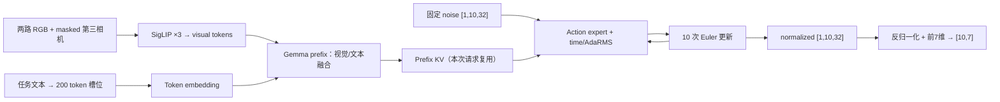
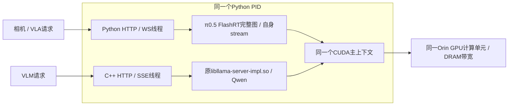

# π0.5 LIBERO / Jetson AGX Orin：部署与加速技术总结

更新日期：2026-10-20。第1–12节保留2026-10-16的 baseline、FlashRT BF16/INT8 测量及 vLLM / TensorRT Edge-LLM 兼容性尝试；第13节新增π0.5与Qwen3.5-9B双模型部署和并发测试。历史引擎逐阶段数值、p95、内存与来源见[对比报告](reports/engine-comparison-2026-10-16/comparison.md)及[CSV](reports/engine-comparison-2026-10-16/comparison.csv)；双模型结果见[新报告](reports/dual-stack-2026-10-20-r2/report_zh.md)。

## 1. 本轮结论

当前设备上，已完成 GPU 推理与分阶段测量的是 OpenPI baseline 和 FlashRT。FlashRT BF16 的纯模型均值为 **232.20 ms/action chunk**，相对同轮 baseline **918.45 ms** 加速 **3.96×**。其稳态进程 NvMap 驱动记账为 **12.79 GiB**，高于 baseline **7.36 GiB**，因此本实现以更高的已分配内存换取更低延迟。BF16 仅有固定合成输入的数值对照，尚不能据此确认机器人任务成功率。

vLLM-Omni 和 TensorRT Edge-LLM **都有官方 π0.5 路径**。本次在 Orin 执行了实际探针，确认当前保留的软件栈无法直接运行其官方新版本；尚未进入模型推理，性能和模型内存均记 **N/A**。不能给出它们比 FlashRT 快或慢的实验结论。

| 路线 | 当前结果 | 纯模型 mean / p95 (ms) | 本机 policy mean (ms) | 稳态 NvMap PID (GiB) |
|---|---|---:|---:|---:|
| OpenPI baseline | GPU 实测 | 918.45 / 945.19 | 927.91 | 7.356 |
| FlashRT BF16 | GPU 实测，固定输入误差已记录 | 232.20 / 233.02 | 240.41 | 12.786 |
| FlashRT INT8 | GPU 实验；动作误差过大，本轮不采用 | 167.67 / 168.22 | 174.11 | 12.754 |
| vLLM / vLLM-Omni | 官方 Pi05Pipeline 存在，当前依赖冲突 | N/A | N/A | N/A |
| TensorRT Edge-LLM v0.11.0 | 原生 LIBERO 路径存在，当前 SDK/API/ABI 不兼容 | N/A | N/A | N/A |

INT8 的 cosine 为 0.580660、RMSE 为 0.415863，不能把其 5.48× 实验速度写成可用策略的加速结果。本轮没有事先规定任务级误差门限，也没有做真实机器人 rollout；“不采用”是依据已观察到的大幅动作偏差所作的工程判断。

## 2. 仓库、目录与分支

私有仓库：[jingyaojade/pi05-orin-benchmarks](https://github.com/jingyaojade/pi05-orin-benchmarks)。

| 分支 | 内容 | 独立目录 |
|---|---|---|
| `main` | 初始 baseline、部署文件、原始测量 | `baseline/`、`deployment/` |
| `flashrt` | baseline 基础上的 FlashRT 编译、补丁、适配与首轮结果 | `flashrt/` |
| `vllm` | vLLM / Omni 的源码审计、Orin 实际导入与 resolver 探针、未来启动配方 | `vllm/` |
| `tensorrt-edge-llm` | Edge-LLM 原生 API/包解析探针、输入/动作适配、未来四组件流程 | `tensorrt_edge_llm/` |
| `engine-comparison` | 合并上述引擎目录，增加同轮延时/内存数据、报告程序和本文 | `profiling/`、`reporting/engine_comparison.py`、`reports/engine-comparison-2026-10-16/` |

新引擎分支从已有 FlashRT 基点分出；各自新增代码仅放在对应目录。本轮共同内存 profiler 和最新汇总数据在 `engine-comparison`，没有重写既有 baseline/FlashRT benchmark。模型、第三方源码、编译产物、虚拟环境及凭据不提交 Git。

Orin 路径：

- 已部署 baseline：`/home/nvidia/pi05-orin`。
- 隔离 FlashRT：`/home/nvidia/pi05-orin-flashrt`。
- vLLM 探针工作区：`/home/nvidia/pi05-orin-vllm`。
- Edge-LLM 探针工作区：`/home/nvidia/pi05-orin-edge-llm`。
- 本仓库：`/home/nvidia/pi05-orin-benchmarks`。

## 3. 实测环境与控制条件

| 项目 | 当前 Orin |
|---|---|
| 设备 | NVIDIA Jetson AGX Orin Developer Kit，64GB，SM 8.7 |
| OS / BSP | Ubuntu 22.04.4，glibc 2.35，L4T R36.3 |
| CUDA Toolkit | 12.2.140 |
| TensorRT | 8.6.2；Debian 包 8.6.2.3 |
| Python | 3.10.12 |
| NVIDIA PyTorch | 2.3.0a0+6ddf5cf85e.nv24.04（包元数据有 nv24.4 表示） |
| Transformers | 4.53.2，使用 OpenPI 官方 transformers_replace |
| 功耗与频率 | MAXN mode 0，动态频率；没有执行锁频或改电源模式 |
| CPU 线程 | OMP_NUM_THREADS=6 |
| 测量负载 | batch=1，单请求串行；其他已有机器人/视频进程仍在运行 |

本轮正式延时约在本地 15:00–15:06 执行；内存与输入/输出边界补测约在 15:07–15:11 执行。原始 JSON 使用 UTC 时间。所有 backend 独立启动新进程，测试期间只暂停本项目的 `openpi-pi05` 服务，未停止其他用户进程。

这是该部署与当时动态频率/背景负载下的基准。未做设备完全空闲、锁频、随机交错顺序的统计试验，不能将相邻小幅差值解释为稳定的硬件上限。初次 baseline 879.12 ms、早先相邻重测和 FlashRT 230.92 ms 等历史数据仍保留在旧报告；本表只用同一新轮次的 918.45 / 232.20 ms，不跨轮拼接最佳值。

## 4. 统一模型与输入输出 contract

使用 OpenPI `pi05_libero`，固定源版本：

- OpenPI：`215abfb217dbac7d5f1273282331b9b1866c0479`。
- 权重：`model.safetensors`，7,233,650,408 bytes，SHA256 `1502e1c5f765ca1bfd6f8f6be0bc769ba2cc263bf298b98bd106d8db168c02e6`。
- tokenizer SHA256：`8986bb4f423f07f8c7f70d0dbe3526fb2316056c17bae71b1ea975e77a168fc6`。
- LIBERO norm stats SHA256：`b3a44bb2810436fb62917decaea58bd4d9110255df527dea21e8fd40c960bd84`。

本轮 fixture 位于 `reports/engine-comparison-2026-10-16/baseline-latency/fixed_inputs.npz`，SHA256 `c7b18b3b0dbbccdc27ac6dc451f871aec0b1be88adfa37c5be2315d12d9451fd`；reference actions SHA256 为 `8263e6fa13339b4268d6b8a1e031816353603994c558f139a2e085df5c1d7faa`。所有实测 backend 复用该文件及同一噪声数组，不依赖不同实现的 RNG seed 恰好一致。

| 输入或内部量 | 形状与语义 |
|---|---|
| 两路真实 RGB | 各 224×224×3，uint8；base 与 left wrist |
| 第三路相机 | 零 uint8 填充，mask=false；baseline 和本次 FlashRT 仍执行该路 vision |
| 任务 | `pick up the black bowl`；容量 200，7 个有效 token |
| 有效 token IDs | 2, 18075, 908, 573, 2656, 14581, 108 |
| state API 输入 | 8 维，处理后 pad；此配置不进入语言 prompt，也没有连续 state projection 条件 |
| 配置 | pi05=true，discrete_state_input=false |
| 视觉 token | 3×256=768；SigLIP 27 层 |
| dense prefix | 768+200=968 行；Gemma prefix 18 层、width 2048 |
| 有效 prefix | 两路视觉 512+7 文本=519；mask/位置需正确保留 |
| 初始噪声 | fixture FP32 [10,32]；batch 后 [1,10,32] |
| action expert | 18 层、width 1024，10 次 Euler 去噪 |
| 模型输出 | [1,10,32] normalized actions |
| 对外输出 | quantile 反归一化并截取前 7 维，得到 [10,7] action chunk |

预测 10 个动作与运行 10 轮去噪是两个独立设置。一个模型调用一次生成整个 chunk；不能将 918 ms 除以 10 当成闭环单步观测到动作延迟。



该 LIBERO 配置的 state 虽是 API 输入，但不参与模型条件；不要画出或实现额外的 state→prompt / state projection 分支。

## 5. 计时方法与分阶段结果

### 5.1 主要计时边界

`baseline/benchmark.py` 与 `flashrt/benchmark.py` 原代码保持不变。每个延时 phase 预热 10 次、测量 30 次，保存逐样本 raw/CSV。

1. **纯模型**：输入已在 CUDA 并完成同步 → 原 sampling 函数或原完整生产 CUDA Graph → GPU 输出完成同步。输入上传、D2H、反归一化和精度比较在边界外；墙钟包含 Python/host 发射、循环/同步控制开销，并非纯 kernel busy time。
2. **本机完整 policy**：CPU 输入准备、传输、模型、下载与动作处理；不包含网络。FlashRT 静态 prompt 在 API 的持久 set_prompt 阶段预先准备，baseline public policy 会处理 prompt，因此讨论模型加速时使用纯模型主指标。
3. **内部诊断**：baseline 用临时 instance wrapper 记录 CUDA events，内部阶段不逐个同步；FlashRT 在生产测量之后捕获独立 vision/prefill/denoise 图。诊断图没有替换原完整生产图。
4. **输入/输出补测**：`profiling/pipeline_latency.py` 单独加入边界同步，测量 FlashRT input_prepare+upload、原完整图和 download+postprocess。输入包括 CPU RGB normalization/cast、noise/image H2D/D2D，不是纯 H2D，未伪造独立 CPU 与 H2D 数字。

CUDA events 是 stream elapsed，可能含 host 发射空隙，不能解释为 GPU 利用率或 kernel busy time。nested stage 不可重复求和；独立诊断图的阶段和也不能取代原图模型墙钟。

### 5.2 分步骤 mean (ms)

| 步骤 | baseline | FlashRT BF16 | FlashRT INT8 实验 |
|---|---:|---:|---:|
| 输入准备+上传 | 6.92 | 7.36 | 5.94 |
| 其中 baseline CPU preprocess | 0.50 | N/A | N/A |
| 其中 baseline H2D+Observation | 6.41 | N/A | N/A |
| Vision ×3 | 83.46 | 40.81 | 35.00 |
| Prefix KV prefill | 290.42 | 140.96 | 96.10 |
| Denoise ×10 | 546.63 | 50.04 | 35.68 |
| D2H+postprocess | 0.66 | 1.16 | 1.14 |
| 未插桩原模型墙钟 | 918.45 | 232.20 | 167.67 |

baseline denoise_iteration 不含随后的 Euler update 和循环控制；FlashRT decoder 图包括其完整 10 轮工作，阶段边界并非每个算子一一相同。baseline 插桩模型墙钟为 927.51 ms，相对未插桩增幅约 0.99%；其余部分包含模型准备、Euler 与控制间隙。细到每张相机、每一轮 denoise、time MLP、action heads 等的原始记录在 baseline latency 的 `stages.csv` / `summary.json`，完整表见自动报告。

BF16 独立同步 pipeline pass 的 input/model/output 均值约 7.36/233.94/1.16 ms，总计 242.46 ms；它不替代另一次原 policy 的 240.41 ms。两者在不同进程及额外同步边界下测得，不能强制相减得到“精确通信时间”。本项目没有测网络延时、pipeline 多请求吞吐或真实控制频率。

## 6. 内存方法、阶段结果与限制

`profiling/memory.py` / `memory_common.py` 是**单独的内存 pass**：各 backend 新进程，预热 5 次，完整模型与细分阶段各重复 3 次。额外设备同步、/proc、sudo、debugfs 读取会扰动运行，不能用其耗时作推理延时。

| 稳态指标 (GiB) | baseline | FlashRT BF16 | FlashRT INT8 实验 |
|---|---:|---:|---:|
| 当前 PID NvMap 驱动记账 | 7.356 | 12.786 | 12.754 |
| 进程 RSS | 2.920 | 0.988 | 1.044 |
| 进程 PSS | 2.896 | 0.964 | 1.020 |
| Torch live allocated | 6.979 | 6.429 | 8.574 |
| Torch reserved | 7.232 | 11.840 | 11.842 |
| 完整模型 pass Torch allocator 绝对峰值 | 7.121 | 6.429 | 8.574 |

稳态取 `steady_state_after_warmup`，在捕获额外诊断图之前。BF16 额外诊断图约增加 NvMap 36 MiB，远小于生产稳态与 baseline 的约 5.43 GiB 差距，不能将主要差距归咎于报告插桩。

内存域必须分别解读：

- **NvMap**：读取 `/sys/kernel/debug/nvmap/iovmm/clients`，K 按 1024 bytes，累加当前 Python PID 的 client，保存整表便于核对。这是 Jetson 驱动记账的当前分配，**不是独占物理 DRAM 总和**。
- **RSS/PSS/USS**：来自 smaps_rollup（RSS 有 status 回退），USS 为 Private_Clean+Private_Dirty。Jetson UMA 下与 NvMap/CUDA 的域有重叠；这些列不能相加。
- **Torch peak/live/reserved**：只覆盖 Torch caching allocator。FlashRT native cudaMalloc、图对象和库内部可能在域外。完整模型 pass 不含内部 peak reset；阶段 pass 另行重置。
- **原生 buffer 清单**：`cuda_buffer_inventory.json` 对 frontend 可达的持久 CudaBuffer 按 pointer 去重；BF16 约 181 MiB，但这不是所有 native CUDA/库内存。
- **cudaMemGetInfo used**：全设备值，包含其他进程和驱动；不能当作当前模型占用或用差值声称精确进程峰值。
- **VmHWM**：进程生命周期 RSS 高水位，包含模型加载。baseline 此值约 15.04 GiB，不能拿它作每次推理额外内存或推理阶段 RSS 峰值。
- **采样峰值**：backend_load、prepare/capture、diagnostic capture、model_total 可后台轮询；等待间隔名义 100 ms，实际每次读取另需约 40–52 ms，真实周期更长。其他 vision/prefill/denoise 等阶段仅在同步前后取快照，因此 NvMap/RSS 观察最大值都是瞬态峰值下界。Torch allocator 的计数器峰值有不同边界，不能混为一谈。

例如 baseline prefill 的 Torch 峰值高于阶段起点约 135.02 MiB，单轮 denoise 最大约 4.34 MiB；FlashRT 对应阶段的 Torch 增量接近 0，因为持久缓冲区已预分配。**0 增量不等于该阶段不使用内存**，其所见常驻权重、KV、scratch 仍然存在。绝对阶段 NvMap/RSS/PSS/Torch 峰值及增量全部列在[各阶段内存表](reports/engine-comparison-2026-10-16/comparison.md#各阶段内存)，不能把这些阶段相加。

FlashRT 的 Torch reserved 比 baseline 多约 4.61 GiB，观测上存在较多缓存容量；加载/调优是可能来源，但本轮没有做控制实验定位全部原因。未调用 empty_cache 后再次测试，也没有承诺清缓存后仍可安全 replay 原始指针图。当前结果忠实记录 as-is 加载/调优后的占用；不能依据 Torch live 或 CPU RSS 更低就宣称整个引擎更省内存。

## 7. Baseline 技术路径

1. 复用已部署 `/home/nvidia/pi05-orin/.venv` 中的 NVIDIA CUDA Torch，不用普通 PyPI CPU/不匹配 aarch64 wheel 替换。
2. 读取固定 OpenPI 源码与官方 LIBERO checkpoint；保存 serve.py、policy、Gemma、SigLIP、PaliGemma、preprocess、tokenizer 等加载文件的 SHA256。
3. 使用 OpenPI 官方 transformers_replace，以保留 prefix/expert attention 与 AdaRMS 逻辑。Python 3.10 的 datetime.UTC 兼容替换只在下载辅助代码，不改模型运算。
4. 部署配置保留官方 BF16/选定 FP32 参数；不启用 torch.compile、不裁剪模型层或去噪轮数。噪声与更新状态在 baseline 中保留 FP32。
5. 用已部署 public Policy.infer 建 reference，再分别测 public policy、同一 sample_actions 的 GPU-ready 模型边界及临时 event 插桩。
6. 每个 measured output 与 reference 严格逐元素一致；恢复 wrapper 后再次调用 public policy 验证。新内存 pass 同时要求与保存 baseline reference 完全一致。
7. 初始服务仍由 systemd `openpi-pi05` 管理，地址 `127.0.0.1:8000`，健康接口 `/healthz`。本轮未把服务默认后端改为 FlashRT。

实现与部署文件见 `baseline/`、`deployment/`、`run_baseline.sh`。权重和下载缓存不进入 Git。

## 8. FlashRT 技术路径

### 8.1 构建与隔离

固定上游 `6cb2f80caec2f561a1331c554a6d3bbf95d2ed55`，CUTLASS v4.4.2。使用独立 venv 并复用已经下载的 NVIDIA Torch wheel，CMake 3.31.10 / pybind11 3.1；未改变 baseline 环境。

虽然上游 Orin 配方使用更新 CUDA，本次在 CUDA 12.2 上成功构建 SM87。关键 CMake 参数为 `GPU_ARCH=87`、`FA2_ARCH_NATIVE_ONLY=ON`、`FA2_HDIMS=96;128;256`、`FA2_DTYPES=bf16` 和 slim build；显式构建 `flash_rt_kernels`、`flash_rt_fa2`，避免默认矩阵中的新架构和不相关 JAX FFI targets。构建 -j2，已完成对象可复用。扩展通过 raw pointer / Python / CUDA 库交互，不要求 Torch/ATen C++ ABI。

执行入口为 `flashrt/prepare_orin.sh`；完整手工命令与依赖在[FlashRT README](flashrt/README.md)。

### 8.2 输入、mask 与精度适配

原 FlashRT 的 camera mask / no-state prompt 缩短方式不直接满足本次 LIBERO contract，因此使用可审核的**三个文件补丁**：

- 保留 3 次 SigLIP、27 vision layers、968 行 encoder GEMM、200 文本容量、10 action rows / 10 denoise steps。
- 固定两路有效相机，第三路 mask=false；Q/residual 保留原布局，RoPE 使用 valid_mask 的 cumsum-1。
- 每个 prefix layer 将完整 200 行 prompt K/V 从 [768:968] D2D 复制到 masked 第三路留下的 [512:712]，源/目标不重叠。
- 使用已有 BF16 FA2 seqused_k 跳过无效 K/V，decoder KV 追加位置为 512+有效文本数。每层两个静态 copy nodes 捕获进 CUDA Graph。
- 该补丁只支持连续尾部相机 mask 以及不超过 gap 的 prompt 容量，未宣称通用动态 image-mask API。attention 可跳过 masked keys，而 baseline dense mask softmax 的计算量不同；不能称所有 FLOPs 完全一致。
- `vision_pool_factor=1`、`cache_frames=1`，没有图像池化、层裁剪、降去噪步数或跨观测缓存。
- 独立 SentencePiece tokenizer 读取同一官方 model，复现 OpenPI no-state 清洗、BOS、分开编码换行和 padding。真实模型下完整 200 token IDs/mask 及缓存协议通过对照，避免 isolated venv 的错误 tokenizer fallback。

`prepare_patch.py` 先检查 pinned upstream hashes，再产出/应用 patch；adapter 再次检查 patched hashes。补丁 SHA256 为 `ee55750fa7742e84cfb80fd8441f3e8c31f16a325327d157b33a0d6b7bc96372`。

FlashRT 会预计算固定步数的 timestep modulation，融合算子，并以 BF16 计算/累积 action state；baseline 有 FP32 更新与选定 FP32 运算。因此这是数值近似实现，不是跨引擎 bitwise 复现。

### 8.3 原始图、诊断图与数值记录

模型主计时 replay **原完整生产图**。该图会覆盖 diffusion noise buffer，所以每次计时前都恢复 fixture noise 并同步；D2H、反归一化、精度比较在 timer 之外。先测未改动 policy 与 full graph，之后才捕获独立阶段图；阶段链要求与本进程 first output 完全相同，结束后原生产图再次校验。

新轮 BF16 latency 对 baseline：cosine **0.9997887039**，RMSE **0.0086131544**，max abs **0.0358229043**。独立 memory 进程为 cosine **0.9997613531**、RMSE **0.0091230038**；每个进程内部重复输出/诊断阶段/恢复图验证通过，但跨进程输出有小幅差异。fixture、reference、tokenizer 与补丁一致；上游有运行时调优，然而本轮未保存全部 tactic 选择并控制重放，**尚不能证明该差异一定由 autotune 引起**。旧轮 0.999833/0.007630 不替代新轮精度。

INT8 使用 encoder+decoder 动态量化，vision INT8 关闭；不是整体每个组件都 INT8。新轮偏差仍大（cosine 0.580660、RMSE 0.415863、max abs 2.299640），只保存实验。没有在机器人上采用或宣称数值等价。

## 9. vLLM / vLLM-Omni 技术路径与阻塞

### 9.1 是否合适

普通 PaliGemma 文本生成支持不能代替 π0.5 action expert / AdaRMS / flow matching。官方 **vLLM-Omni Pi05Pipeline** 已实现完整 π0.5，见[固定 recipe](https://github.com/vllm-project/vllm-omni/blob/90576488ae85de6ac355bb7aa3e9470c38303bba/recipes/lerobot/Pi05.md)。该路径当前以 eager 功能实现为主，没有此模型的 CUDA Graph/Triton 或跨请求 prefix/encoder cache；文档所列 H100/4090/RTX PRO 验证不能当成 Orin 的性能结论。这里没有声称它在同一次去噪中必然重算所有 prefix。

本任务是 Orin batch=1 的 chunk 延迟；vLLM 的存在不保证更快。当前优先级低于已跑通的 FlashRT，迁移的实际收益需要新栈实测才能判断。

### 9.2 已实际执行

固定 vLLM `fa75d3456d60a5ffe923818c4b495295675b38e1`，Omni `90576488ae85de6ac355bb7aa3e9470c38303bba`；`sources.json` 锁定审计文件 SHA256。

- 在 Orin 实际导入官方 Pi05 原文件，权重 loader 的依赖导入即报 `No module named vllm`，未构建模型。
- 在独立空 venv 中执行 vLLM+Omni 0.30.0 的 uv install **dry-run**：vLLM 要求 Torch 2.13.0，与保留 NVIDIA Torch 2.3 的 constraint 冲突。
- 0.31.0 release dry-run 同样冲突；锁定的当前源码 HEAD 则要求 Python >=3.11,<3.15 和构建 Torch 2.14，与本机 Python 3.10 不符。发布 wheel 与源码 HEAD 的要求分开记录。
- 检查 Torch 2.3 对应的 vLLM v0.5.0（`8f89d72090da70895d77d32248ea8504f7daba50`）：该 tag 的 registry 没有 Pi05。此结论只覆盖检查过的 tag，没有穷举所有 forks。
- 没有安装新包进入 baseline、没有 GPU 初始化或模型推理。probe 的 CPU RSS/耗时不计为引擎内存/延迟。

原始输出和 resolver 文本在[vLLM compatibility.json](vllm/results/2026-10-16/compatibility.json)。官方[安装说明](https://docs.vllm.ai/en/latest/getting_started/installation/gpu/)要求 CUDA/Torch 不匹配时走源码构建；当前新版本 aarch64 binary 不能因 CPU 架构相同就视为适配 Jetson CUDA 12.2。

### 9.3 后续新栈所需工程（本轮未执行）

官方现成 recipe 使用 LeRobot pi05_base，默认 50×32 并将 state 序列化进 prompt；本次 LIBERO 是 no-state 10×7，不能直接换权重套同一表。需要固定现有 checkpoint，做完整 key/shape/dtype 映射、zero missing/skipped 验证，保持同一 fixture/noise/tokenizer/归一化；适配不序列化 state 的底层输入或 processor，再核对 prefix mask、KV、AdaRMS、10 步输出。

Omni 的 mixed-precision 规则和 baseline 不完全相同，需记录 FP32 vision/projector 等差异，再做同精度/近似对照。必须通过真正的 Pi05Pipeline/DiffusionEngine 运行；只拷出数学模块用普通 Torch 跑，不计为已完成 vLLM 引擎。

`serve_official_recipe.sh` 是**未执行的新栈 base 配方**，不自动下载模型，不是本次 LIBERO 的完成版加速器。详细输入和验证待办在[vLLM README](vllm/README.md)。

## 10. TensorRT Edge-LLM 技术路径与阻塞

### 10.1 是否合适

官方 v0.11.0 `95515c2f87fba8982db5a519f9022277667b3cc9` 已提供实验性原生 π0.5，并支持 pi05_libero。它把模型拆为 **visual、prefix、action、cond 四组件**，FP16；action 走专用 attention plugin，cond 可按固定步数缓存。结构方向适合 Jetson 原生部署，但本机现有 SDK 不能直接运行。[官方 π0.5 示例](https://nvidia.github.io/TensorRT-Edge-LLM/latest/user_guide/examples/vla/pi05.html)、[固定源码与全部证据](tensorrt_edge_llm/source_audit.json)。

### 10.2 已实际执行

| 真实 Orin 检查 | 结果 |
|---|---|
| TensorRT 头文件 control 编译 | 成功，确认编译器和 include 路径有效 |
| addAttention / addRotaryEmbedding | TRT 8.6 均缺少成员 |
| IPluginV3OneBuildV2 | 类型不存在 |
| getDeviceMemorySizeV2 | 成员不存在 |
| 隔离 uv package dry-run | aarch64 wheel 要求 glibc 2.39，本机 2.35，被拒绝 |
| 官方源文件 hash | 锁定七项证据校验通过 |
| 模型构建/推理 | 未执行；延时与模型内存 N/A |

原生 ONNX schema 明确要求 TensorRT >=10.15 的 Attention/RoPE；官方 Orin payload 对应 JetPack 7.2 / CUDA 13.2 / TensorRT 10 平台。旧 v0.10.1/v0.6 树没有原生 pi05，不能简单回退旧包后假定功能仍在。详见[实际探针](tensorrt_edge_llm/results/compatibility-2026-10-16/compatibility.json)及各 C++ error logs。

容器/venv 可以隔离 Python 和用户态，但不能自动解决当前 BSP/Jetson iGPU 驱动与新 native payload 的兼容性。当前 Docker 可用，阻塞并非 Docker 缺失。也不能把 CUDA 12.2 单独解释为所有 TRT10 永远不可运行：通用 TRT10.15 有 CUDA12.x 支持，但 SBSA 库不等于 Jetson iGPU 发行版。本轮只证明当前安装栈与官方发行路径不兼容，没有证明经过独立工程验证的 source port 理论上不可能。

### 10.3 已准备但未执行的完整原生流程

`run_native_supported.sh` 带新 glibc / TRT 版本 guard，没有升级宿主。新兼容栈上应按下列顺序：

1. 在独立 exporter 环境准备固定 release 依赖（包括 Torch 2.13 / Transformers 5.14.1）；可在另一台兼容导出主机生成 ONNX。
2. 使用**现有** model.safetensors/config.json 与 norm stats，不另下不同 LeRobot 权重。配置为 pi05_libero / action_horizon10 / action_dim32 / no-state / max_token200。
3. FP16 导出 visual、prefix、action、cond、policy contract、embedding/tokenizer sidecars；保留源 tensor→目标 tensor 全映射、dtype 转换和 hash，并验证所有必需 tensor 已加载。**当前没有执行 exporter，zero-missing 和逐 tensor 映射尚未验证。**
4. 官方 Jetson Orin CMake toolchain 构建 pi05_policy_build / pi05_policy_inference，设置 EMBEDDED_TARGET=jetson-orin、CUDA_CTK_VERSION=13.2、BUILD_EXPERIMENTAL_MODELS=ON；解析/加载 action 时使用同次构建插件。
5. `prepare_inputs.py` 将同一 fixture 转为 FP16 [2,3,224,224] pixels、同一任务 token IDs、字节一致的原始 FP32 [1,10,32] noise，同时生成 raw observation JSON。
6. 跑 canonical tensor 与 raw policy 两个入口，固定 10 steps / warmup10 / iters30。分别保存 normalized 与 robot-unit 输出。
7. `compare_actions.py` 用原 quantile stats 将 normalized32维还原/截取为 robot7维再比较；不能拿两个不同动作表示直接计算误差。
8. 核对 GPU-ready→GPU-ready 模型边界、visual/prefix/action/cond setup 和 runtime 的 stream/host timer，再接同样 RSS/NvMap 测量；普通 C++ TensorRT 分配不经过 Torch allocator。

本轮**已完成 CPU adapter 验证**并在 Orin 生成输入：真实 OpenPI tokenizer 方法得到相同7tokens，noise字节一致，pixels布局/FP16字节正确。动作转换检查用标记的合成结果，只证明表示转换，不是 Edge-LLM 推理精度。

native 会跳过 masked 相机和文本 padding，prefix 为 **519 行、2 路 vision**，而本次 baseline/匹配布局 FlashRT 保持 968 行、3 路 vision。此优化在当前 mask/RoPE 语义下可等价，但减少了工作量；将来结果必须说明 compaction 和 FP16 精度变化，不能宣称只有 kernel 替换。cond 固定步数缓存后稳态不重复计费，仍需单独记录 cold/setup。官方 engine-chain host time、stream-event sum 与完整 policyMs 是不同边界，不可混加。

完整准备命令与限制见[Edge-LLM README](tensorrt_edge_llm/README.md)。未把普通 TensorRT fallback 的估算或 CPU 转换时间冒充 Edge-LLM 性能。

## 11. 复现、数据校验与服务恢复

在 Orin 仓库根目录、已存在的 baseline/FlashRT 环境下：

```bash
# 新目录；每轮只暂停/恢复一次本项目服务，会短暂影响该服务请求。
bash profiling/run_latency.sh reports/new-engine-round
bash profiling/run_profiles.sh reports/new-engine-round

# 两个 CPU 兼容性探针，各自用不存在的输出目录。
bash vllm/run_probe.sh /home/nvidia/pi05-orin-vllm/new-results
/usr/bin/python3 tensorrt_edge_llm/probe.py \
  --output /home/nvidia/pi05-orin-edge-llm/new-results \
  --fetch-source --resolve-package

# 使用本轮已提交 manifest 重建报告；新轮须先修改 manifest 中所有路径。
python reporting/engine_comparison.py \
  --manifest reports/engine-comparison-2026-10-16/manifest.json \
  --output reports/engine-comparison-2026-10-16/comparison.md

# CPU accounting 与接口检查，不代表 GPU 正确性/性能。
python -m unittest discover -s profiling/tests -v
python profiling/memory.py --help
python profiling/pipeline_latency.py --help
```

结果目录拒绝覆盖已有非空内容。正式 raw/summary/provenance、fixture/reference、逐样本 CSV、内存 snapshots.jsonl 与原始 nvmap/proc 文本均保留。memory profiler 和 pipeline 脚本记录自身 SHA256；baseline/FlashRT provenance 记录实际加载源码、patch、模型/资源 hash。自动报告只读取 manifest 指定数据，不给 blocked 路线填零。

本轮实际 latency 使用原先逐后端 wrapper；随后增加 `run_latency.sh` 将同样 benchmark 命令合为单次 service stop/start。内存主脚本运行完成后，旧频繁启停触发 unit 已有的“10分钟最多启动3次”限制（不是模型 crash）。已仅对该服务 reset-failed 并恢复启动，健康检查正常；没有修改 unit 的频率配置。新 wrapper 只在 Result=start-limit-hit 时做该恢复，其他启动失败仍报错。该外层服务恢复修正不改变已测模型/内存代码。

已执行验证包括 GPU baseline/FlashRT 正式测量、独立内存 pass 的输出/恢复一致性、CPU NvMap 与 buffer 去重单元检查、Orin shell 语法检查、新引擎实际兼容性探针，以及 Edge 输入/动作表示 CPU 检查。新引擎 export/build/inference 尚未通过，因此没有相应 GPU 指标。

## 12. 当前可操作选择与未完成边界

当前可继续评估 FlashRT BF16：约 232 ms 生成一个 10×7 chunk，实际内存占用增加；上线到机器人前仍需更多观测、不同噪声、跨进程稳定性和任务 rollout。INT8 当前误差较大，先保留实验。

若下一步要跑 Edge-LLM，最明确的路线是在备份/独立设备上准备官方支持的 Jetson 新 SDK，再跑已准备的四组件流程、验证现有权重完整映射和 FP16 动作偏差；这属于后续环境迁移，当前未执行。vLLM-Omni 还需 LIBERO/no-state/horizon10 与权重适配；其当前 eager recipe 不是已证明的低延迟 Orin 后端。

本报告不提供未执行路径的预计性能，也未把网络/预处理 pipeline 的潜在重叠收益算进模型加速比。

## 13. π0.5 + Qwen3.5-9B 双模型部署（2026-10-20）

### 13.1 路线、目录与固定版本

新分支为 `vla-vlm-qwen35`，从 `engine-comparison` 的 `b878a9d` 创建。
新增代码统一位于[dual_stack](dual_stack/README.md)，正式数据位于
`reports/dual-stack-2026-10-20-r2`，权重、上游源码和二进制均在Orin
`/home/nvidia/pi05-orin-dual`，不进入Git。没有升级JetPack、驱动、系统CUDA或原baseline的Torch。

VLA复用已验证源码补丁的FlashRT BF16和同一官方π0.5 LIBERO checkpoint，
仍是两路有效224×224 RGB、一路masked padding、200文本token容量、10轮去噪、10×32内部动作、10×7机器人单位输出。
该LIBERO配置不将state加入prompt；API接受8维state以兼容原观测结构。
新服务不固定正常调用的采样噪声：未传noise时每次产生新的FP32标准正态[10,32]。
只有测量请求显式使用已提交的固定noise。

VLM采用Qwen3.5-9B的公开Unsloth GGUF：语言模型Q5_K_M，视觉/mmproj为FP16。
匹配视觉权重不可省略，否则不能完成看图推理。固定文件及revision见
[sources.json](dual_stack/sources.json)：

| 内容 | 固定版本/身份 |
|---|---|
| llama.cpp | `3bb63cbcbfb62056c84fe9e521b0f3d756d29c32` |
| GGUF repository revision | `3885219b6810b007914f3a7950a8d1b469d598a5` |
| Qwen3.5-9B-Q5_K_M.gguf | 6,577,841,376 bytes；SHA256 `dc2a39aef291f91a9116ad214058da0d86eb648743a124bd8c333787c4b9c91c` |
| mmproj-F16.gguf | 918,166,080 bytes；SHA256 `f70dc3509053962b0d0d3ee8a7eacebf5d60aa560cad78254ae8698516ae029f` |
| 本轮重新校验的π0.5模型 | SHA256 `1502e1c5f765ca1bfd6f8f6be0bc769ba2cc263bf298b98bd106d8db168c02e6` |

Orin直连HF/GitHub传输不稳定，先尝试经本机代理转发，再使用HF mirror的相同revision做64MiB分块、8路下载。
连接重置后保留完整分块重试，最后组装并校验完整文件SHA；镜像只改变传输路径。
没有把下载成功等同于文件身份正确，校验记录保存在`evidence/verified-models.json`。

### 13.2 Orin原生构建与服务接口

在Ubuntu22.04 / L4T36.3 / CUDA12.2上，从固定源码tar构建aarch64 SM87 Release，
使用已有FlashRT隔离环境的CMake3.31.10；开启`GGML_CUDA`，关闭NCCL和native CPU自动选择。
只构建本轮所用FP16 KV对应的`GGML_CUDA_FA_QUANTS=f16-f16`，减少不需要的CUDA模板编译；
这不改变语言模型Q5_K_M权重，也不改变VLA的BF16路径。
产物为`llama-server`和`llama-mtmd-cli`。tar包没有.git信息，因此`--version`显示commit unknown，
精确源码身份以固定commit、tar SHA和构建产物SHA为准，保存在`evidence/build-artifacts.json`。

VLM单slot、context8192、4个CPU线程、`-ngl 99`、FlashAttention开启、attention KV为默认FP16，
关闭thinking和prompt cache；请求温度0、seed42、最多96输出token。两个512×384合成桌面图交替输入，
实际prompt为226 tokens，输出14或15 tokens，无长度截断、无复用prompt tokens。
这组完整回答延时对应短中文描述，不能推广到长回答或更大图像。

VLA由新的loopback JSON服务包装原完整生产CUDA Graph，在上传、模型、下载边界同步计时。
正常同prompt请求缓存文本；更改prompt会重新prepare/capture，并把setup计入该次请求。
实际检查了固定输入重复、改变相机图像、改变prompt及恢复prompt，输出均为有限[10,7]且对观测变化有响应。

持久服务为`openpi-pi05-flashrt-dual`和`qwen35-vlm`，均已active、enabled，检查时重启次数均为0。
原baseline unit与部署文件保留，但已停止并取消自启，避免重复加载π0.5。
新VLA HTTP为`127.0.0.1:8081`，VLM兼容接口为`127.0.0.1:8082/v1/chat/completions`。
同一VLA进程还提供原OpenPI msgpack WebSocket `127.0.0.1:8000`及`/healthz`，通过JSON入口转发，不复制模型。
兼容桥另安装websockets15.0.1与msgpack1.1.2，使用原官方msgpack_numpy序列化helper。
该入口的PNG编码与内部HTTP转发增加开销；正式API延时使用8081入口，WS另外做了真实推理检查。
可在VS Code转发上述端口。恢复原服务执行`bash dual_stack/restore_original.sh`。

### 13.3 测量矩阵与计时边界

正式r2按系统空闲30秒、VLA单独、VLM单独、双常驻空闲30秒、双常驻仅VLA、
双常驻仅VLM、同时持续推理执行；单模型场景至少60秒，并发实际182.4秒。
VLA有启动10次内部warmup和5次client warmup；VLM排除2次warmup。
共记录1041次请求，其中1029次正式测量、12次client warmup；遥测551条，逐场景筛选时间戳。
编译和权重下载均在测量前完成。

VLA报告输入准备/上传、原完整模型、下载/动作处理与HTTP解码，所有正式输出与各自进程的首个固定输出逐元素一致。
跨进程调优可能改变数值，两个实例相对baseline的RMSE分别0.008445和0.007907，
cosine分别0.999796和0.999820；没有进行真实机器人rollout。
本轮没有将原生产图替换为逐层同步图，也未重新声称测得了内部vision/prefix/action的并发独立耗时。
历史内部拆分见第5、7、8节；不能把不同测量口径拼成一次请求。

VLM TTFT从发送HTTP请求到首个非空可见content，不计role空包和reasoning。
保存全部SSE、usage、prompt/decode内部timings和实际输出长度。
该llama.cpp版本首token在prompt阶段产生，decode速率用后续N−1个间隔除以predicted_ms，
与服务回传的predicted_per_second口径一致。
prompt_ms不是独立视觉编码耗时，TTFT还包含图像处理、排队和HTTP；没有将差值伪装为精确vision kernel计时。
两侧客户端的PNG/base64均提前准备，未计相机采集、图像编码或外部网络RTT；
VLA API计时包括客户端JSON序列化，VLM在构造请求后开始计时。

### 13.4 延时、内存、温度与功耗结果

| 场景 | VLA 模型 mean / p95 ms | VLA API mean / p95 ms | VLM 首字 mean / p95 ms | VLM 完整 mean / p95 ms | VLM decode tok/s |
|---|---:|---:|---:|---:|---:|
| 各模型单独运行 | 220.80 / 220.99 | 250.43 / 253.92 | 688.39 / 693.08 | 1330.82 / 1356.49 | 21.02 |
| 双常驻，仅其中一个推理 | 220.94 / 220.80 | 250.45 / 252.45 | 688.20 / 694.17 | 1330.30 / 1354.72 | 21.03 |
| 双模型同时持续推理 | 427.42 / 472.93 | 463.69 / 511.56 | 1350.02 / 1374.63 | 2846.74 / 2915.75 | 9.01 |

“仅其中一个推理”一行的VLA和VLM来自两个独立场景。VLA该场景有一次304.82ms模型耗时，
因此均值略高于p95，这不是百分位计算错误；保留原样本和min/max。
同时推理使VLA模型均值约为单独的1.94倍，VLM完整短回答约2.14倍。
双常驻本身没有明显拖慢其中一个模型，而持续同时计算带来显著延时增长。
未通过kernel级profiling进一步区分计算、带宽和GPU调度贡献。

并发场景系统RAM峰值28.17GiB、MemAvailable最低33.37GiB；全部场景RAM最高28.18GiB。
并发VLA NvMap约12.76GiB、RSS最大约1.01GiB；VLM NvMap约7.78GiB、RSS最大约1.42GiB。
这些UMA记账有重叠，不能求和为物理总占用。Torch最终live/reserved约6.43/11.84GiB，
allocator lifetime peak含加载阶段，不能当作推理阶段新增内存。
系统Swap观测最大0.75MiB，不是模型独占Swap；本轮未发生OOM。

三分钟并发中CPU/GPU/tj最高71.16/73.28/73.28°C，板载三轨合计平均45.82W、1Hz采样最大49.70W。
VLA单独平均46.85W，VLM单独40.48W，双常驻空闲7.47W，系统空闲5.82W。
总三轨为VDD_GPU_SOC+VDD_CPU_CV+VIN_SYS_5V0；DDR的VDDQ已包含于5V轨，不再重复加，SUMMATION也不再加。
这是包含系统背景的板载传感器近似值，不是外接AC功率计结果，也未扣空闲计算模型净功耗。
[NVIDIA电源轨与OC说明](https://docs.nvidia.com/jetson/archives/r36.3/DeveloperGuide/SD/PlatformPowerAndPerformance/JetsonOrinNanoSeriesJetsonOrinNxSeriesAndJetsonAgxOrinSeries.html#software-based-power-consumption-modeling)。

OC3计数在两次VLA加载场景分别增加1和3，正式持续推理场景的首末采样未观察到增加；
1Hz轨功耗可能漏掉触发限制的瞬时尖峰，不能据此声称完全没有限频。
全程保留原MAXN、CPU/GPU动态频率、现有EMC override与动态风扇状态，没有更改功耗或热策略。
固定场景顺序、几分钟测试不构成长时间热稳态认证。

### 13.5 监控修正、原始证据和复现

首轮发现tegrastats若在GPU温度传感器不可读时启动，后续可能持续省略GPU温度。
该轮主动终止，未当作完成结果；Orin保留未完成原始目录，正式报告中仅附其provenance和原因。
`telemetry.py`新增每秒直接读取cpu/gpu/tj/tboard thermal sysfs，保存原始毫摄氏度或不可读状态，
休眠时GPU缺失值不填零、不以tj代替。修正后完整重跑r2，正式推理场景均取得GPU温度。

监控拥有自己的tegrastats子进程，不使用全局`--stop`；逐秒保存原始电源轨、温度、GR3D负载、
RAM、进程RSS/PSS/USS、NvMap、MemAvailable、Swap、OC事件和采集开销。
读取非原子、1Hz峰值可能漏掉瞬时峰值，监控开销没有单独标定。
原始请求在`requests.jsonl`，原始遥测在`telemetry.jsonl`，全部统计见`summary.json`和`metrics.csv`。
环境前后快照、构建参数、模型和二进制hash、API检查、systemd状态与原服务状态均保存在正式目录及`evidence/`。
GPU运行时脚本SHA保存在provenance；报告生成和绘图属于后处理，实际源码SHA、输入SHA和图表SHA另记在postprocessing.json。

完整复现和服务恢复命令见[dual_stack README](dual_stack/README.md)。
已通过Orin实际CUDA构建、完整场景测量、输出一致性/观测变化检查、WS/兼容API检查、
4项功耗/首字/百分位CPU检查和shell语法检查。
报告附[实测时间轴](reports/dual-stack-2026-10-20-r2/timeline.png)，不插值补造缺失温度。

当前部署让两种模型独立提供服务，没有连接物理机器人或让VLM自动执行控制。
若更重视动作更新延时，可先按事件/低频触发VLM；持续并发的优先级或协同调度尚未实施测试，
不能把未来pipeline、调度或提高分辨率的潜在收益计入本轮结果。


## 14. 同进程共享CUDA上下文实验（2026-10-20）

### 14.1 改造目标与实现路径

分支`vla-vlm-shared-context`，新增独立目录`shared_context/`；原`dual_stack/`未修改。
目标是检验同一Python进程、同一个CUDA context能否改善双模型同时推理，保持同一模型、量化、输入和服务协议。
正式报告为[同进程共享上下文版测评](reports/shared-context-2026-10-20/report_zh.md)。

查验固定llama.cpp版本后发现，`llama-server`入口只是调用`llama_server(argc, argv)`；
完整HTTP/SSE、视觉与文本后端已经编译在`libllama-server-impl.so`。
因此没有重写Qwen推理或另装版本不同的llama-cpp-python，也没有重编原llama动态库。
`bridge.cpp`给既有C++入口添加C ABI；`ctypes.CDLL`在Python原生线程里调用它，调用期间释放GIL。
原生服务及其线程仍在，但不存在独立llama-server模型进程。
22个原llama动态库路径的SHA均与之前部署记录一致；模型与fixture SHA沿用原实验。

Torch先进行一次实际CUDA分配与stream等待，建立主上下文。仅调用set_device会惰性初始化，
首轮预检因此失败；随后VLA请求线程和原生Qwen入口显式cuCtxSetCurrent到这个context。
VLA仍回放原完整生产CUDA Graph，逐请求图像和noise上传、输出下载不变；
将VLA全设备等待改为其自身stream等待，输出转换也在自身stream执行。
C++后端内部同步保持原实现，本轮没有逐层重写后端，也没有保证所有kernel会同时执行。



共享上下文和VLA同步范围是组合改动，主实验没有分别估计两者的独立贡献。
上下文共享本身不共享两个模型的权重、KV cache或逻辑张量，也不会增加硬件带宽。
CUDA上下文机制见[NVIDIA CUDA 12.2文档](https://docs.nvidia.com/cuda/archive/12.2.2/cuda-c-programming-guide/index.html#concurrent-kernel-execution)。

### 14.2 证明上下文相同，而非只看PID

`bridge.cpp`的CUPTI launch API callbacks记录context指针/UID、原生线程ID、角色和API名。
`preflight.py`加载两模型后执行真实VLA请求与Qwen图文请求，要求两个角色的launch都在同一非零context，
且VLA存在GraphLaunch、Qwen存在Launch、记录无丢弃。
独立预检得到VLA角色16条、Qwen角色16592条launch API记录，全部相同context。
这些是API调用记录数，可能包含runtime/driver两层，不等于kernel数。
证据见`evidence/context-validation.json`和`context-audit.json`。

普通用户CUPTI返回错误35（权限不足），故仅此独立诊断使用sudo运行，正式性能实验仍使用nvidia普通用户。
首轮惰性初始化与第二轮权限失败日志保留，不将失败当成成功结果。
CUPTI没有在主延时测量中启用；本轮未量出kernel重叠率、SM/Tensor Core或DRAM峰值利用率。

### 14.3 新的对照方法

`benchmark.py`重新测量原双进程A，再测量共享上下文B；相同VLA fixture/noise，
同一Qwen Q5_K_M + FP16 mmproj、8192 context、单slot、-ngl99、相同batch/ubatch/线程数与flash-attn。
相同两张512×384合成图片交替输入，prompt cache关闭、thinking关闭、temperature0、seed42、最多96输出tokens。
实际回答14/15 tokens，226 prompt tokens，没有cache复用或长度截断。

每个变体包含系统空闲30s、加载、排除内部/客户端预热、双常驻空闲30s、
只运行VLA约60s、只运行VLM约60s、同时持续推理至少180s、VLA2Hz/VLM0.2Hz约60s。
持续负载每模型最多一个在途请求、完成立即触发下一次；指定频率采用跳过过期触发策略，避免无限排队。
主对照1721个正式请求、14个客户端预热；16K另8个正式短请求、7个预热。
主变体阶段内遥测分别440/442条，保留逐次JSONL，不用理论估算代替GPU测量。

所有固定VLA输出在各实例内逐元素一致；相对官方baseline的cosine为0.999796/0.999813，
RMSE为0.008445/0.008085。相机变化会改变动作，未传noise时逐次采样。
两模型没有连接真实机器人，固定合成输入不代表任务成功率。

### 14.4 实际收益与代价

| 同时持续推理指标 | 本轮双进程A | 同进程共享上下文B |
|---|---:|---:|
| VLA模型 mean / p95 ms | 427.71 / 473.68 | 428.22 / 504.69 |
| VLA API mean / p95 ms | 464.09 / 511.68 | 460.37 / 537.48 |
| VLM首字 mean / p95 ms | 1359.17 / 1375.74 | 1222.87 / 1255.51 |
| VLM完整 mean / p95 ms | 2856.64 / 2923.37 | 2302.75 / 2346.91 |
| VLM decode tok/s | 9.01 | 12.50 |
| 系统RAM max / MemAvailable min GiB | 29.00 / 32.51 | 29.03 / 32.49 |
| GPU / CPU最高 °C | 71.44 / 69.06 | 75.88 / 72.31 |
| 板载三轨平均 / 最大 W | 46.09 / 49.84 | 48.95 / 52.81 |

共享版VLM短回答耗时缩短约19.4%，decode提高约38.7%；VLA模型均值基本不变，p95变差。
两模型双常驻但仅其中一个计算时，两实现都约VLA221ms、VLM完整1.34s，说明主差别发生在同时计算。
指定VLA2Hz/VLM0.2Hz时，VLA实际完成率A/B分别1.807/1.640Hz，
VLM均约0.201Hz；VLA模型均值313.52/301.59ms，但p95为482.24/512.00ms。
因此不能用均值略降就声称动作控制达到稳定2Hz，候选版未改善VLA尾延时。

本次结果修正了“同进程可以消除并发翻倍”的预期：减少进程/上下文边界只解决一部分问题，
计算单元、带宽、同步与调度仍然共享。没有kernel级证据，不能给这些瓶颈分别分配百分比。
功耗/温度固定先A后B，起始温度不同，原动态频率/风扇/功耗策略未改变，不把温差全归因于代码。
共享模型加载阶段OC3增加7，持续并发阶段A/B均未观测增加；不能据此排除全部瞬时限频。

### 14.5 内存占用与如何利用余量

Orin的CPU/GPU共享SoC DRAM，容量有余量不等于计算或内存带宽有余量。
[NVIDIA Tegra内存说明](https://docs.nvidia.com/cuda/archive/12.2.2/cuda-for-tegra-appnote/index.html#memory-management)。
共享进程NvMap约20.45GiB，只记录一次PID；RSS、PSS、NvMap、Torch allocator和系统RAM存在重叠，不能相加。
Torch live/reserved仍约6.43/11.84GiB，并不包含原生llama的全部CUDA内存。
共享版并发RAM约29GiB、可用约32.5GiB，容量并未耗尽；GPU活跃时间平均约97.29%，
但这个百分比不是SM/Tensor Core占用率，也不是DRAM带宽利用率。

本轮额外将Qwen单slot context容量从8192增加到16384，共享PID在双常驻空闲时NvMap最大值
20.453→20.729GiB，增加0.275GiB。日志显示配置已生效，8个短图片问答成功；
这只是容量与短请求探针，没有执行16K实际长度输入，也不能把整个PID差值严格归因为单独KV buffer。

有效利用余量的方向：更长上下文/历史、更多视觉token、Q8或FP16语言权重、
多请求槽位或批量、正确失效的前缀/特征缓存和复用缓冲。
这些分别服务于长对话、细节/精度或吞吐；没有保证单次延时下降，部分会加重VLA争用。
当前π0.5仍固定经过验证的224×224输入，提高原相机分辨率不会自动让该模型使用更多token。
本轮仅context8K→16K实际运行，其他方向未冒充实测结论。
不通过空tensor、无用cache或重复加载模型来追求占用比例；关注任务质量、p95、吞吐、带宽及功耗的共同收益。

### 14.6 文件职责、复现与部署状态

- `bridge.cpp`、`build_bridge.sh`：C ABI、显式context绑定、独立CUPTI诊断，编译小型shim。
- `service.py`、`run_service.sh`：同进程模型、HTTP/SSE/WS兼容入口、VLA stream同步。
- `preflight.py`：独立上下文身份证据与接口检查。
- `benchmark.py`、`support.py`：匹配A/B负载、周期触发、原服务状态保存和恢复。
- `report.py`、`plot_results.py`：读取原始数据生成分步统计、内存/温度/功耗报告及时间轴；后处理源码与输入SHA单记。
- `activate.sh`、`rollback.sh`、`lifecycle_test.py`：hash门槛、systemd候选切换、三个端口同PID验证、接口检查与回退。

候选服务`openpi-vla-vlm-shared`已在8081/8082/8000实际运行并通过测试；
原生线程同属一个Python PID，没有独立llama-server子进程。
为了避免Qwen活动期间重捕获VLA CUDA Graph，本候选版固定原fixture任务prompt，
不同任务明确返回409；尚无更换任务的配置入口，单纯重启不会改变任务。
当前默认已回退原`openpi-pi05-flashrt-dual`和`qwen35-vlm`，均恢复active/enabled；
恢复后动态任务、图像响应、HTTP/SSE和WS重新检查通过。
候选unit和二进制保留，可按README切换，不影响原双进程实现。

首次切换验证记录已保存；后续有一次临时取证命令转义错误、紧接恢复后检查早于API就绪，
该次操作日志保留并标为未完成。新增生命周期脚本等待各API就绪后重新完成全流程，
成功证据见`evidence/lifecycle-validation.json`和两个API smoke文件。
正式性能数据先于这些切换检查产生，未混入诊断/服务切换耗时。
完整步骤见[shared_context README](shared_context/README.md)。


## 15. Thor Docker源码构建包（2026-10-20）

用户后续目标可能为Thor，目前没有可连接设备，故交付源码构建包，GPU验收待设备到位。
分支`docker-thor`，独立目录[containers](containers/README.md)。没有修改原模型、FlashRT适配器或双进程实现。
本地无Docker，当前Orin SSH超时；不能声称已经生成可运行镜像或测得Thor性能。

Thor与本轮Orin同为ARM64，但GPU为SM110/SM87，候选用户态为CUDA13/12.2、Python3.12/3.10。
NVIDIA PyTorch25.08与JetPack7.0兼容表对应，作为固定候选基础；最终需检查目标机实际版本。
Dockerfile在独立venv中保留基础容器Torch，安装原OpenPI依赖及官方4.53.2 transformers_replace，
固定OpenPI和llama.cpp commit，llama.cpp重新按SM110构建；基础镜像tag在构建时解析为digest并留档。
完整pip freeze及源码SHA保存在构建镜像内；完整transitive lock尚需首次Thor构建后固化。

Thor首版VLA明确为PyTorch BF16、10轮去噪，Qwen仍为Q5_K_M语言权重+FP16 vision，双进程。
现有FlashRT写明SM87限制，源码/补丁保留，未仅改架构断言冒充完成Thor适配。
`vla_pytorch_server.py`复用baseline加载、输入准备、模型调用和输出变换，提供8081 HTTP及8000 WS，
Qwen独立进程8082；`runtime.py`管理自己创建的子进程，不触及宿主机systemd、功耗、风扇或其他容器。
`benchmark_container.py`使用相同fixture、noise、图片问题和触发方式，保存逐请求数据及组件计时。
原baseline分层插桩另通过baseline命令运行；没有把FlashRT图或旧计时伪装成Thor PyTorch数据。

`assets.py`只导出并逐个验证五个指定权重/tokenizer/norm文件，约14.73GB，模型独立只读挂载。
`package_buildkit.py`从提交的Git blob生成带逐文件SHA的源码tar.gz，不带权重、编译二进制或凭据。
权重可以从恢复连接后的Orin导出，也可从其他已有副本提供，不要求构建时连接原Orin。
最终镜像经Thor doctor/模型接口/数值/测量验收后再docker save，用于其他兼容Thor。

监控采用Thor候选NVML查询、自己子进程proc及原始hwmon，缺失为N/A，不假定NvMap或Orin三轨规则适用。
设备内存、RSS及主机MemAvailable不可相加；设备报告功耗不能直接当成Orin三轨合计或整机AC功耗。
跨平台应先比较Orin PyTorch与Thor PyTorch；比较Thor PyTorch和Orin FlashRT会混入后端差异。
已通过5项CPU检查、Python编译和shell语法检查，验证边界见[准备记录](containers/validation_2026-10-20.md)。
